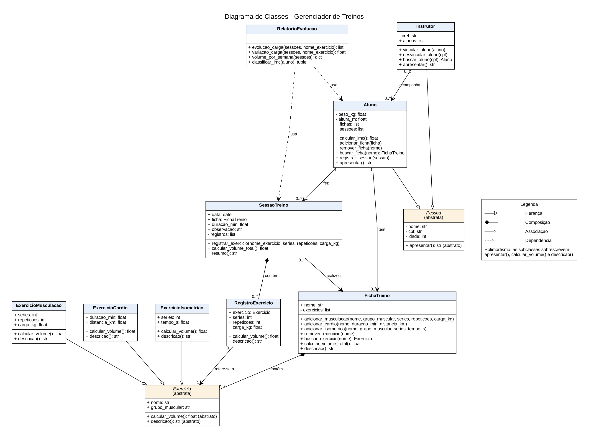

# Gerenciador de Treinos

Aplicativo desktop em Python para gerenciar treinos de academia, feito para a disciplina de
Orientação a Objetos (UnB). Permite cadastrar alunos e instrutores, montar fichas de treino
(A, B, C…), registrar os treinos feitos e acompanhar a evolução de carga.

## Modelagem (nível 1)



| Relação | Onde aparece |
| --- | --- |
| Herança | `Aluno` e `Instrutor` herdam de `Pessoa`; `ExercicioMusculacao`, `ExercicioCardio` e `ExercicioIsometrico` herdam de `Exercicio` |
| Polimorfismo | `apresentar()` em cada pessoa; `calcular_volume()` e `descricao()` em cada exercício |
| Composição | `FichaTreino` cria e contém seus `Exercicio`s; `SessaoTreino` cria e contém seus `RegistroExercicio`s |
| Associação | `Instrutor` acompanha `Aluno`s; `Aluno` tem `FichaTreino`s e `SessaoTreino`s; `SessaoTreino` aponta para a ficha feita; `RegistroExercicio` aponta para o exercício |
| Dependência | `RelatorioEvolucao` usa sessões e alunos recebidos por parâmetro, sem guardá-los |

O código-fonte do diagrama está em `docs/uml.puml` (PlantUML).

## Como rodar

Requisito: Python 3.10 ou mais novo.

```bash
pip install -r requirements.txt

# demonstração das classes
python src/main.py

# testes
python -m pytest -v
```

## Estrutura

```
src/
├── main.py                 # demonstração (nível 2: menu)
├── models/
│   ├── validacao.py        # validação das entradas
│   ├── pessoa.py           # Pessoa, Aluno, Instrutor
│   ├── exercicio.py        # Exercicio e as 3 subclasses
│   ├── ficha_treino.py     # FichaTreino
│   └── sessao_treino.py    # SessaoTreino, RegistroExercicio
└── services/
    └── relatorio.py        # RelatorioEvolucao
tests/                      # testes com pytest
docs/                       # diagrama UML
```
