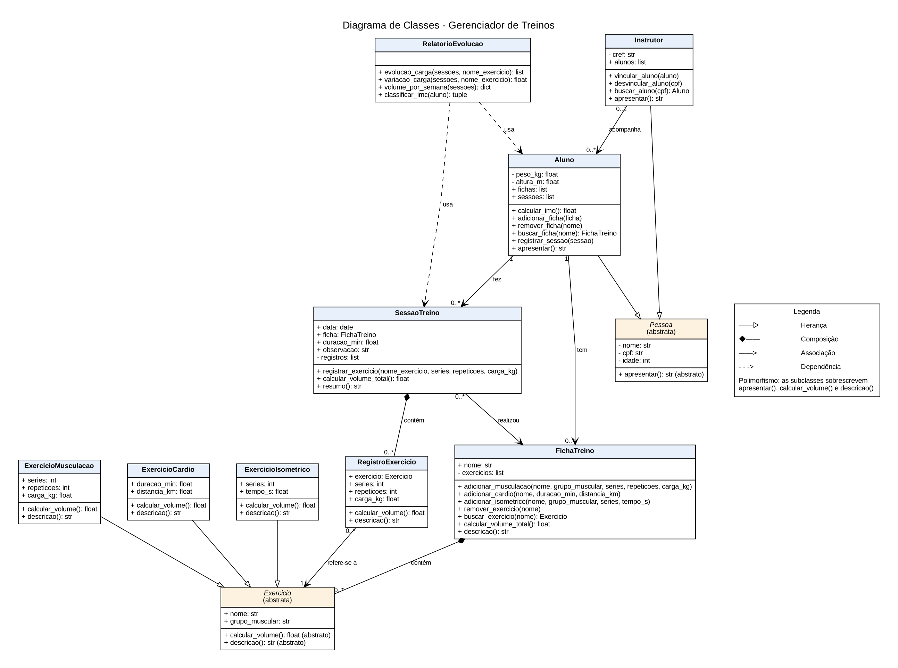

# Gerenciador de Treinos

Aplicativo desktop em Python para gerenciar treinos de academia, feito para a disciplina de
Orientação a Objetos (UnB). Permite cadastrar alunos e instrutores, montar fichas de treino
(A, B, C…), registrar os treinos feitos e acompanhar a evolução de carga.

## Como rodar

Requisito: Python 3.10 ou mais novo.

```bash
pip install -r requirements.txt

# interface gráfica (nível 4)
python src/gui.py

# menu do terminal (os dados ficam salvos em treinos.db)
python src/main.py

# ver o conteúdo das tabelas do banco
python src/ver_banco.py

# testes
python -m pytest -v
```

O banco `treinos.db` é criado sozinho na pasta do projeto na primeira vez que o programa
abre. Para começar do zero, é só apagar esse arquivo. O SQLite (`sqlite3`) e o Tkinter já
vêm com o Python, não precisa instalar nada além do `pytest`. A interface gráfica e o menu
do terminal usam o mesmo banco.

## Interface gráfica (nível 4)

Feita com **Tkinter + ttk** (tema `clam`), com estilos personalizados: paleta de cores
própria (laranja e grafite), menu lateral escuro, botões com cores por função
(principal, secundário, excluir), tabelas com cabeçalho escuro e linhas coloridas por tipo de
exercício, e gráficos desenhados à mão num `Canvas`.

| Tela | O que faz |
| --- | --- |
| Início | totais (alunos, instrutores, fichas, sessões), atalhos e botão de dados de exemplo |
| Alunos | tabela com busca; cadastrar, editar (duplo clique) e excluir |
| Instrutores | cadastrar e excluir; vincular e desvincular alunos |
| Fichas e exercícios | criar e excluir fichas; adicionar exercícios de musculação, cardio ou isométrico; volume de cada um e total |
| Registrar sessão | marcar os exercícios feitos, com os campos de cada tipo já preenchidos com o planejado |
| Histórico | sessões do aluno em ordem de data e os detalhes de cada uma |
| Relatórios | gráfico de evolução de carga, gráfico de volume por semana e IMC com régua de faixas |

Erros (campo vazio, número negativo, CPF repetido, data inválida…) aparecem numa janela de
aviso, e o formulário continua aberto para corrigir. Cada ação bem-sucedida aparece em verde
na barra de status.

Como o código está organizado (`src/ui/gui/`):

- `ControladorGUI` (`controlador.py`) é a parte que **não** usa Tkinter: recebe os textos
  digitados, cria os objetos e chama o repositório. Por isso é testado com pytest
  (`tests/test_controlador_gui.py`), com os dois repositórios.
- `TelaBase` (`tela_base.py`) é uma classe **abstrata**; as 7 telas **herdam** dela e
  implementam `montar()` e `atualizar()`. A `JanelaPrincipal` chama `tela.atualizar()` sem
  saber qual tela é (**polimorfismo**).
- `estilos.py` guarda as cores, fontes e estilos; `componentes.py` tem as peças reutilizadas
  (tabela, caixa de escolha, formulário, gráfico de barras).

## Menu do terminal (níveis 2 e 3)

```
1 - Alunos                      cadastrar, listar, editar e excluir
2 - Instrutores                 cadastrar, listar, vincular/desvincular alunos e excluir
3 - Fichas de treino            criar, listar e excluir fichas de um aluno
4 - Exercícios de uma ficha     adicionar (musculação, cardio ou isométrico), remover e ver
5 - Ver ficha                   descrição e volume de cada exercício e volume total
6 - Registrar sessão de treino  data, duração, observação e o que foi feito em cada exercício
7 - Histórico de sessões        todas as sessões do aluno em ordem de data
8 - Relatórios                  evolução de carga, volume por semana e IMC
9 - Carregar dados de exemplo   instrutor, alunos, fichas e sessões prontos para demonstrar
0 - Sair
```

Todas as entradas são validadas (campo vazio, número negativo, texto no lugar de número,
CPF inválido ou repetido, data inválida, opção inexistente): o programa mostra uma mensagem
de erro e pergunta de novo, em vez de quebrar.

## Banco de dados (nível 3)

Os dados ficam num banco SQLite (`treinos.db`) e continuam lá depois de fechar o programa.
Cada alteração (cadastrar, editar, excluir, registrar sessão...) é salva na hora, então nada
se perde nem se o programa for fechado com Ctrl+C.

| Tabela | O que guarda | Ligações |
| --- | --- | --- |
| `instrutores` | cpf, nome, idade, cref | — |
| `alunos` | cpf, nome, idade, peso, altura | `instrutor_cpf` → instrutores (fica vazio se o instrutor for excluído) |
| `fichas` | nome da ficha | `aluno_cpf` → alunos |
| `exercicios` | tipo (musculação, cardio ou isométrico) e os dados de cada tipo | `ficha_id` → fichas |
| `sessoes` | data, duração, observação | `aluno_cpf` → alunos, `ficha_id` → fichas |
| `registros` | séries, repetições e carga feitas no dia | `sessao_id` → sessoes, `exercicio_id` → exercicios |

Como o código funciona:

- `RepositorioSQLite` (`src/repository/banco.py`) **herda** de `RepositorioMemoria`. Cada método
  que altera dados chama `super()` (que valida e altera os objetos) e depois executa o SQL
  (`INSERT`, `UPDATE` ou `DELETE`).
- Ao abrir, ele lê as tabelas e monta os objetos de novo; a coluna `tipo` diz qual subclasse
  de `Exercicio` criar.
- O menu recebe o repositório e não sabe qual dos dois é (**polimorfismo**): `main.py` usa o
  SQLite, e os testes rodam o menu com os dois.
- Excluir um aluno apaga as fichas, exercícios e sessões dele (`ON DELETE CASCADE`).
  Um exercício que já aparece em sessões sai da ficha, mas continua no histórico (`ativo = 0`).

## Modelagem (nível 1)



| Relação | Onde aparece |
| --- | --- |
| Herança | `Aluno` e `Instrutor` herdam de `Pessoa`; `ExercicioMusculacao`, `ExercicioCardio` e `ExercicioIsometrico` herdam de `Exercicio`; `RepositorioSQLite` herda de `RepositorioMemoria` |
| Polimorfismo | `apresentar()` em cada pessoa; `calcular_volume()`, `descricao()` e `descrever_registro()` em cada exercício; o menu usa qualquer um dos dois repositórios |
| Composição | `FichaTreino` cria e contém seus `Exercicio`s; `SessaoTreino` cria e contém seus `RegistroExercicio`s |
| Associação | `Instrutor` acompanha `Aluno`s; `Aluno` tem `FichaTreino`s e `SessaoTreino`s; `SessaoTreino` aponta para a ficha feita; `RegistroExercicio` aponta para o exercício |
| Dependência | `RelatorioEvolucao` usa sessões e alunos recebidos por parâmetro, sem guardá-los |

O código-fonte do diagrama está em `docs/uml.puml` (PlantUML).

## Estrutura

```
src/
├── gui.py                        # ponto de entrada: interface gráfica (nível 4)
├── main.py                       # ponto de entrada: abre o menu com o banco
├── ver_banco.py                  # mostra o conteúdo das tabelas do banco
├── models/
│   ├── validacao.py              # validação das entradas
│   ├── pessoa.py                 # Pessoa, Aluno, Instrutor
│   ├── exercicio.py              # Exercicio e as 3 subclasses
│   ├── ficha_treino.py           # FichaTreino
│   └── sessao_treino.py          # SessaoTreino, RegistroExercicio
├── services/
│   └── relatorio.py              # RelatorioEvolucao
├── repository/
│   ├── repositorio_memoria.py    # guarda os dados na memória (nível 2)
│   └── banco.py                  # RepositorioSQLite: guarda tudo no SQLite (nível 3)
└── ui/
    ├── menu_terminal.py          # menu do terminal
    ├── dados_exemplo.py          # dados prontos para demonstração
    └── gui/                      # interface gráfica (nível 4)
        ├── janela_principal.py   # janela com menu lateral e troca de telas
        ├── controlador.py        # ControladorGUI: lógica das telas, sem Tkinter
        ├── estilos.py            # cores, fontes e estilos ttk
        ├── componentes.py        # Tabela, Seletor, JanelaFormulario, GraficoBarras
        ├── tela_base.py          # TelaBase (abstrata)
        └── tela_*.py             # as 7 telas
tests/                            # testes com pytest (modelos, repositórios, banco, menu e GUI)
docs/                             # diagrama UML
```
